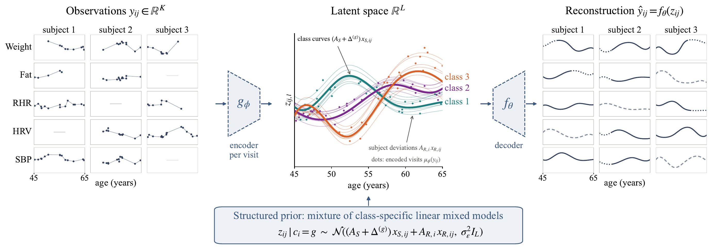

<div align="center">

# Latent Class Mixed Model Variational Autoencoders for Scalable Phenotyping of Health Trajectories

Philomène Letzelter, Violaine Courrier, Sandrine Katsahian, Agathe Guilloux<br>
*Machine Learning for Health (ML4H) 2026*

</div>

LCMM-VAE is a variational autoencoder whose latent prior is a mixture of class-specific linear mixed models: each subject's latent trajectory is its class trajectory plus subject-specific random effects. It is fitted by variational EM, with the responsibilities, random effects and mixed-model parameters updated in closed form and the encoder, decoder and observation variance by gradient descent. A fitted model returns a partition of the subjects, a reconstruction of their incomplete trajectories and a decoded trajectory per class.



## Installation

```bash
git clone https://github.com/philomeneletzelter/lcmm-vae.git
cd lcmm-vae
pip install -r requirements.txt
```

Requires Python >= 3.11.

## Data

A dataset is a directory of three CSV files with one row per visit: `data.csv` (the markers in their own units, no header), `mask.csv` (1 observed, 0 missing, no header) and `label.csv` with columns `unit` (subject), `t` (visit time) and optional covariate columns. The real datasets are downloaded and written in this format by `python -m data_loader.gait` and `python -m data_loader.physionet`; the simulated cohorts are generated automatically by the simulation experiments.

## Usage

Training is run by `train.py` and configured by a YAML file.

1. Configure the model: edit a config in `configs/`, or start from `configs/template.yaml` for a new dataset.

2. Train it from the root directory of the project:

```bash
python train.py --config configs/gait.yaml --out results/gait
```

The fitted model is saved to `results/gait/model.pt`. Its interface is the `LCMMVAE` class in `src/estimator.py`: reload a fitted model with `LCMMVAE.load`; `labels_` gives the class of each subject, `class_trajectories(t)` the class trajectories and `reconstruct(data)` the individual trajectories (see the docstrings for the other outputs).

## Reproducing the paper

```bash
python -m data_loader.gait
python -m data_loader.physionet
python -m experiments.simulation.run
python -m experiments.gait.run
python -m experiments.physionet.run
python -m experiments.tables
```

## Project structure

```
lcmm-vae/
├── configs/        # one config per dataset, template.yaml
├── data/           # written by data_loader/
├── data_loader/    # simulation, gait, physionet
├── experiments/    # one runner per dataset, tables.py
├── src/
│   ├── modules/          # encoder, decoder, priors
│   ├── estimator.py      # LCMMVAE
│   ├── model.py          # networks
│   ├── closed_forms.py   # E- and M-step
│   ├── initialisation.py # em-EM initialisation
│   ├── trainer.py        # training loops
│   ├── data_io.py, datasets.py, utils.py
└── train.py
```
